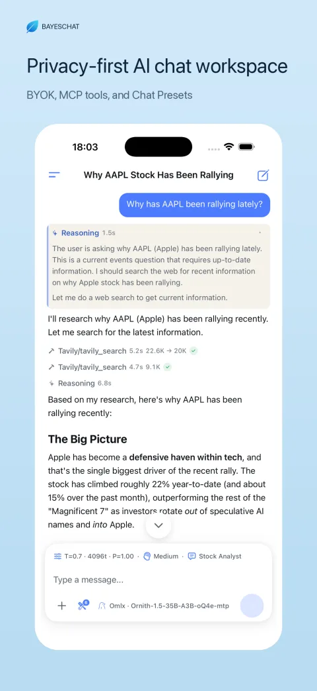
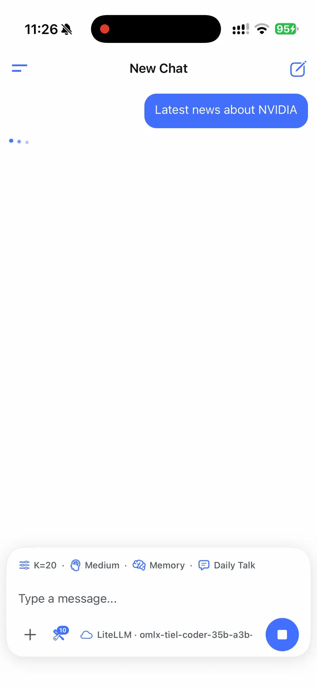
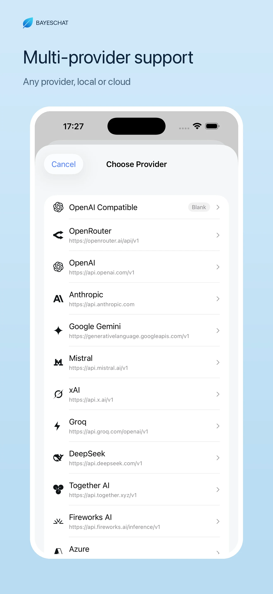
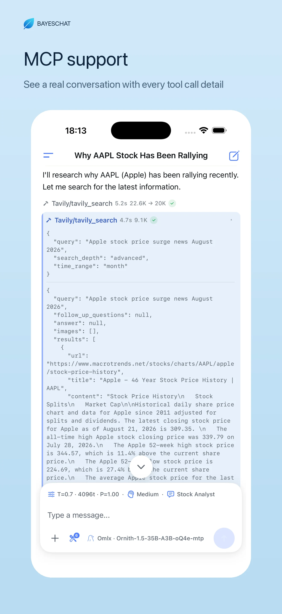
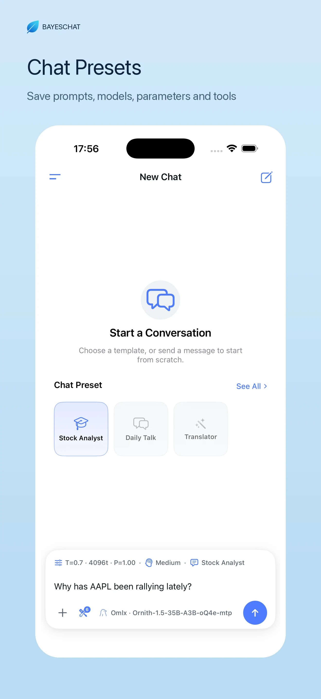
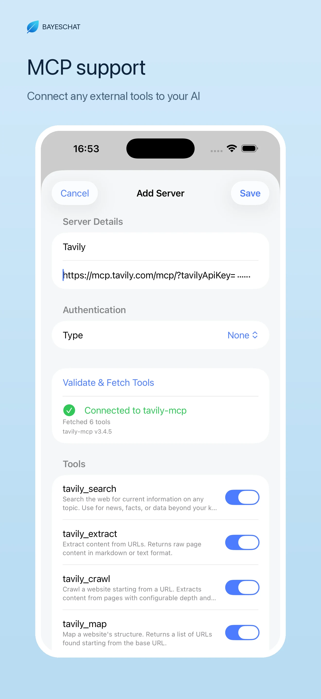
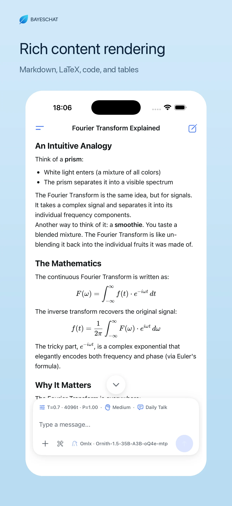
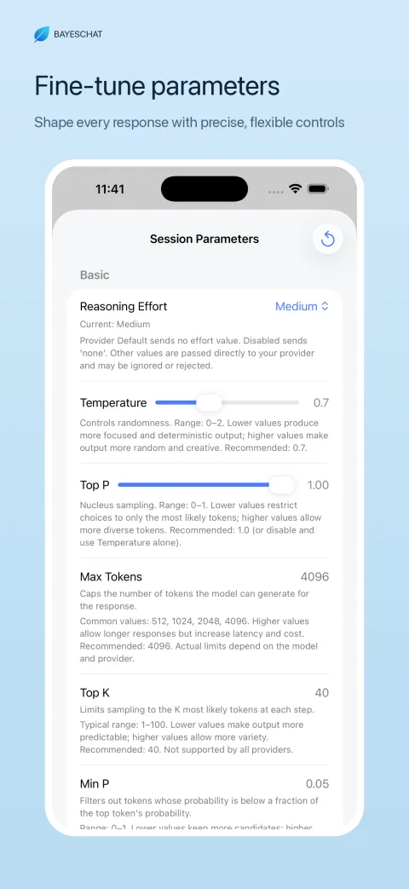
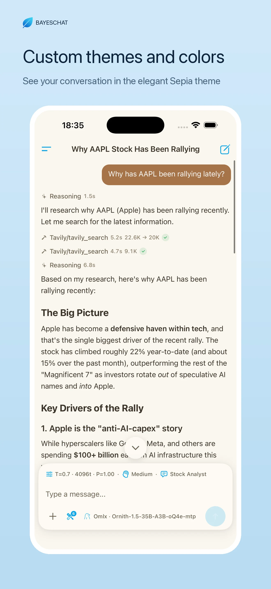

# BayesChat

**Your own API key. Your own MCP tools. Your own settings. On your phone.**

No account. No analytics. No server in the middle.

`iOS 17+` · `iPhone & iPad` · `22 languages` · [App Store](https://apps.apple.com/app/id6777948055) · [Website](https://bayeschat.xyz)

---

## BYOK: any provider, any endpoint

Point BayesChat at whatever you already pay for, and manage it from one place.
Nothing is hardcoded — if an endpoint speaks a supported protocol, it works.

- **OpenAI** (Chat Completions and the Responses API), **Anthropic** (Messages),
  **Google Gemini**, **OpenRouter**, plus any **OpenAI-compatible** endpoint
- **Custom base URLs**, with the protocol detected from the URL you paste
- **Local runtimes** — Ollama, LM Studio, llama.cpp server — including Ollama's
  own `keep_alive` handling so your model stays warm between turns
- **Per-provider custom headers**, including `{session_id}` and `{model_id}`
  placeholders for gateways that need them
- **Live model lists** — the picker shows what your key can actually call, not a
  hardcoded table
- Keys live in the **Keychain**, never in plain files

## MCP: real tools on the phone

Most MCP tooling stops at the desktop. BayesChat connects to **remote MCP servers
over Streamable HTTP** and runs their tools inside the conversation.

- Add a server, choose **bearer token** or **custom headers**, then **Validate &
  Fetch Tools** — you see the connection succeed and the tool list arrive
- **Toggle tools individually**, so a server can expose twenty and the model only
  gets the three you want
- Every call renders **inline** with its arguments, latency, token delta and
  result — expandable, copyable, cancellable
- **Concurrent calls** within a round instead of a queue, **retry in place** when
  one fails, and a **Continue** prompt when a model stops after calling tools
  without writing its final answer
- Long tool output is truncated intelligently instead of blowing out the context

> iOS cannot spawn child processes, so **stdio servers don't apply**. Remote HTTP
> servers do — and that's the whole design.

## Chat Presets: the whole request, saved

A preset is not a saved prompt. It's the entire configuration for one kind of
task, switched in one tap.

- Stores **provider + model + system prompt template + every sampling parameter**
  (temperature, top-p, top-k, min-p, max tokens, penalties, seed, stop sequences,
  reasoning effort, and raw extra JSON for provider-specific fields)
- Stores **which MCP tools are allowed** and **whether long-term memory is on** —
  so switching tasks also switches the tool permissions and the memory rule
- Presets **inherit your global parameters or override them** individually
- Reusable **prompt templates** expand `{{current_date}}`, `{{current_time}}`,
  `{{current_weekday}}`, `{{current_datetime}}`, `{{timezone}}`, `{{model_id}}`
- Per-preset **icon and description**, a default preset, and last-used ordering
- The composer **only shows the parameters that differ from the defaults**, so a
  tuned preset looks different at a glance

## Memory: long-term context you can read

Memory is not a black box that quietly rewrites your prompt.

- Learned from your conversations, then **merged under explicit capacity and
  protection rules** instead of blindly appended
- Every entry is **visible, editable and deletable** — you can fix what it got
  wrong, or delete a single fact without wiping everything
- Shown as a **pill in the composer** so you always know whether memory is active
  for this conversation
- Settles **inside the same run as the answer**, so a finished reply means the
  memory is finished too

## Background answers: leave the app, nothing stops

Long answers and multi-step tool runs **keep going after you send the app to the
background**, with progress on the **Lock Screen and in the Dynamic Island** —
including a cancel control.

- Built on iOS 26's continued-processing API, so the network stays alive instead
  of being suspended
- **Live Activity** shows what's running and how far along it is
- **Opt-in notification** when it finishes; tapping it opens the conversation
  that finished
- Conversation title and memory updates are finished **inside the same background
  run**, so nothing is half-written when you come back
- On older iOS versions the app falls back to the normal background grace period

## Privacy: nothing leaves the device

The product promise is verifiable, not just stated.

- **No account, no sign-up, no identity** — nothing to log in to
- Requests go to exactly two kinds of hosts: the provider endpoint you configured,
  and the MCP servers you added. Nothing else
- Conversations, presets and memory are stored **locally on the device**
- API keys and MCP credentials in the **Keychain**
- **No tracking, no analytics SDK, no third-party telemetry** — the app's privacy
  manifest declares no collected data types and no tracking domains
- Export and back up your data and take it with you, without asking anyone

---

## Screenshots

  
  
  

<b>Any provider, local or cloud</b> &nbsp;·&nbsp; <b>MCP tool calls, fully expanded</b> &nbsp;·&nbsp; <b>Presets that store prompts, models, parameters and tools</b>

  
  
  

<b>Add a remote MCP server, fetch its tools</b> &nbsp;·&nbsp; <b>Markdown, LaTeX, code and tables</b> &nbsp;·&nbsp; <b>Sampling controls, per preset</b>

  

<b>Themes and typography</b>

## Everything else

| | |
|---|---|
| **Reasoning models** | `<thinking>` tags and `reasoning` / `thinking` fields parsed and rendered as their own block, collapsible and copyable |
| **Rendering** | Markdown, KaTeX math, syntax-highlighted code, tables — with a steady typewriter reveal and lighter transcript typography |
| **Attachments** | Images, video and documents; tap a photo to open the **original resolution**, not the compressed preview |
| **Streaming detail** | Live `tok/s`, latency and up/down token counts under every reply |
| **Composer** | Auto-grows with your text, expands into a full-screen editor, submits with the keyboard Send key, with parameter / reasoning / memory / preset pills in one row |
| **Conversation control** | AI-generated titles, edit and regenerate, long-press to edit / copy / delete, pinned message that holds still while cards expand |
| **Navigation** | Slide-out history drawer from the left edge, jump-to-bottom that appears only when it's needed |
| **Export** | Batch export conversations to **PDF or HTML** (zip), plus a full local backup |
| **Appearance** | Light and dark, six transcript themes including sepia, adjustable typography |
| **Localisation** | **22 languages**, including Simplified and Traditional Chinese |
| **Onboarding** | A setup guide that gets you from install to first answer, and a What's New card after each update |

## Requirements and limits

- **iOS / iPadOS 17 or later.** Background continuations and the Live Activity
  require **iOS 26**.
- **Remote MCP servers only.** iOS cannot spawn local processes, so `stdio`
  servers are not supported by any iOS client — including this one.
- The model does the thinking. BayesChat does not proxy, resell or route your
  requests through anyone.

## Documentation

| | |
|---|---|
| [Can you use MCP on an iPhone?](docs/01-mcp-on-ios.md) | Why stdio can't work on iOS, and what does |
| [Connecting a remote MCP server](docs/02-connect-mcp.md) | Bearer tokens, custom headers, tool toggles |
| [Presets and prompt templates](docs/03-presets.md) | What to store per task, with three ready-made recipes |
| [BYOK, explained](docs/04-byok.md) | What bringing your own key actually changes |
| [MCP troubleshooting](docs/05-troubleshooting.md) | The eight reasons a server won't connect |
| [Background answers on iOS](docs/06-background.md) | What the OS allows, and when |

## Support

- Open an issue here for bugs and questions
- [Privacy policy](https://bayeschat.xyz/privacy.html) · [Changelog](CHANGELOG.md)

---

This repository is the public home for BayesChat: documentation, screenshots and
release notes. The app itself is closed source and distributed through the App Store.
